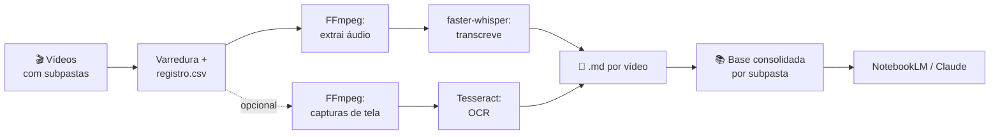

# Transcritor Local

Transforma uma pasta de vídeos (aulas, palestras, reuniões gravadas) em **arquivos Markdown pesquisáveis**, prontos para alimentar IAs como **NotebookLM** e **Claude**. Tudo roda **no seu PC**: nenhum vídeo, áudio ou texto é enviado para a internet.


<details><summary>Outras telas: Vídeos, Resultados e Preparação do PC</summary>


</details>

> **Status:** v0.1 (beta). Testes automatizados passam em Windows e Linux (Python 3.11 e 3.13) e o `.exe` é gerado e testado no GitHub Actions; falta validar a janela em um PC real. Veja o [Roadmap](docs/ROADMAP.md).

---

## Por que existe

Vídeos de 500 MB a 1 GB não cabem no upload de nenhuma IA, e "conversores de MP4 para texto" online cobram, limitam o tamanho ou exigem enviar o conteúdo para terceiros. Este projeto resolve isso localmente:

| Problema | Solução |
|---|---|
| Vídeo grande demais para upload | Extrai só o áudio (1 h de vídeo vira ~20 MB) |
| Transcrição paga | [Whisper](https://github.com/openai/whisper) open source via [faster-whisper](https://github.com/SYSTRAN/faster-whisper), rodando na CPU |
| Conteúdo que aparece só na tela | Capturas de tela + OCR com [Tesseract](https://github.com/tesseract-ocr/tesseract) |
| Dezenas de vídeos, horas de processamento | Lotes controlados, estimativa de tempo, retomada automática |
| Conteúdo sigiloso ou protegido | 100% local; a internet só é usada para baixar o modelo na primeira vez |

## O que ele faz

- 🎙️ **Transcrição literal** com timestamps a cada ~1 min, em português (ou outro idioma)
- 🖼️ **Texto da tela (opcional):** detecta trocas de slide/tela e lê o texto via OCR, inserindo-o no ponto certo do `.md`
- 📁 **Subpastas espelhadas:** `videos/Módulo 01/aula.mp4` → `transcricoes_md/Módulo 01/aula.md`
- 📚 **Base consolidada por módulo**, respeitando o limite de 500 mil palavras por fonte do NotebookLM
- 🧾 **`registro.csv`** (abre no Excel/Power BI): detecta vídeo novo, **substituído**, **excluído** e com **erro**
- ⏱️ **Estimativa de tempo** que aprende a velocidade real do seu PC
- 🖥️ **Verificação de hardware:** diz o que ajuda, o que atrapalha e qual qualidade usar
- 🔤 **Vocabulário de dicas** para nomes que o Whisper erra (ex.: *Power BI, DAX, ChatGPT*)
- ✏️ **Correções automáticas** por projeto (`correcoes.json`): "Chatepte" → "ChatGPT", contadas no cabeçalho do `.md`
- 🧰 **Preparação guiada** na primeira abertura: verifica o PC, baixa o modelo com barra de progresso e ajuda a instalar o Tesseract
- 🛑 **Parar com segurança** após o vídeo atual; nada se perde; não deixa o PC suspender no meio

## Como funciona



Detalhes em [Arquitetura](docs/ARQUITETURA.md) e nas [Decisões técnicas](docs/DECISOES.md).

## Instalação

### Opção A: executável para Windows (recomendado para usuários comuns)

1. Baixe o `.zip` mais recente em **Releases** (versões estáveis) ou, para a versão de teste, em **Actions → Build Windows (.exe) → execução mais recente → Artifacts → TranscritorLocal-windows** (role até o fim da página)
2. Descompacte em uma pasta **fora do OneDrive** (ex.: `C:\TranscritorLocal`). É um zip só; dentro há um único programa e o arquivo `COMO_ABRIR.txt`
3. Abra `TranscritorLocal.exe`. Na primeira vez, a página **Preparação do PC** baixa o modelo de transcrição (~1,6 GB, uma única vez)

Python e FFmpeg já vêm embutidos. Na primeira abertura, o Windows pode exibir *"O Windows protegeu o computador"*, porque o app ainda não tem assinatura digital: clique em **Mais informações → Executar assim mesmo**.

### Opção B: pelo código-fonte (Python 3.10+)

```powershell
winget install --id Gyan.FFmpeg -e          # FFmpeg (obrigatório)
winget install --id UB-Mannheim.TesseractOCR -e   # Tesseract (opcional, para texto da tela)
git clone https://github.com/nicorosseto/transcritor-local
cd transcritor-local
python -m pip install -r requirements.txt
python -m transcritor          # abre a janela
python transcrever.py          # ou: modo terminal, usando as pastas ./videos e ./saida
```

Passo a passo para iniciantes, incluindo solução de erros comuns: **[Guia do usuário](docs/GUIA_DO_USUARIO.md)**.

## O que sai

```
<pasta de saída>/
├── transcricoes_md/      um .md por vídeo, mesma estrutura de pastas
├── base_consolidada/     base_<subpasta>.md, pronta para NotebookLM/Claude
├── capturas/             imagens das trocas de tela (se o OCR estiver ligado)
├── audio_mp3/            áudio leve de cada vídeo (reaproveitável)
├── _orfaos/              transcrições de vídeos que foram removidos da pasta
└── registro.csv          histórico, status e velocidades (Excel/Power BI)
```

Exemplo de trecho gerado (conteúdo fictício):

```markdown
**[00:12:05]** Agora a gente vai criar a medida de total de vendas usando SUM...

> 🖼️ **Na tela [00:12:08]** · [captura](../../capturas/Modulo 01/aula03/cap_001208.jpg)
> Total Vendas = SUM(Vendas[Valor])
```

## Desempenho de referência

| PC | Qualidade | Velocidade medida |
|---|---|---|
| Xeon E5-2620 v3 (6C/12T, 2014), 16 GB, só CPU | Preciso (`large-v3-turbo`, beam 5) | **1,48x** (36:43 de vídeo em 24:49) |

"1,48x" = 1,48 minuto de vídeo transcrito por minuto real. Placas **NVIDIA** aceleram 5x ou mais; placas AMD/Intel não são usadas pelo motor atual (ver [ADR-001](docs/DECISOES.md)).

## Limitações conhecidas

- Transcrição é **automática**: revise nomes próprios e termos técnicos
- Não identifica **quem** fala (sem diarização)
- O OCR lê **texto**, mas não entende **ações** ("clicou em tal botão") nem gráficos. A descrição por IA visual local está prevista para a [v0.2](docs/ROADMAP.md)
- A lista completa, com status de cada item, está na [Auditoria](docs/AUDITORIA.md)

## Privacidade e direitos autorais

- O processamento é local. Os únicos acessos à internet são: download do modelo Whisper (Hugging Face, uma vez) e do pacote de português do Tesseract (GitHub, ~2 MB, uma vez).
- **Não publique transcrições de cursos pagos** nem de material de trabalho sem autorização. O `.gitignore` deste repositório bloqueia vídeos, áudios e saídas justamente para evitar isso.

## Documentação

| Documento | Conteúdo |
|---|---|
| [Guia do usuário](docs/GUIA_DO_USUARIO.md) | Instalação e uso passo a passo, erros comuns |
| [Arquitetura](docs/ARQUITETURA.md) | Módulos, fluxo de dados, eventos, registro |
| [Decisões técnicas (ADRs)](docs/DECISOES.md) | Por que cada escolha foi feita |
| [Histórico do projeto](docs/HISTORICO.md) | Como o projeto evoluiu e o que aprendemos |
| [Auditoria](docs/AUDITORIA.md) | Lacunas encontradas, corrigidas e pendentes |
| [Auditoria independente — Codex (08/10/2026)](docs/auditorias/2026-10-08/README.md) | Achados técnicos, evidências, revisão de interface e proposta de layout |
| [Status das auditorias](docs/auditorias/STATUS.md) | O que foi corrigido, em qual teste, e o que falta |
| [Retomada](docs/RETOMADA.md) | Onde o projeto parou e qual é o próximo passo |
| [Roadmap](docs/ROADMAP.md) | Próximas versões |
| [Licenças de terceiros](docs/LICENCAS_TERCEIROS.md) | FFmpeg, Whisper, Tesseract e bibliotecas |

## Licença

[MIT](LICENSE). Componentes de terceiros têm licenças próprias, listadas em [LICENCAS_TERCEIROS.md](docs/LICENCAS_TERCEIROS.md).
