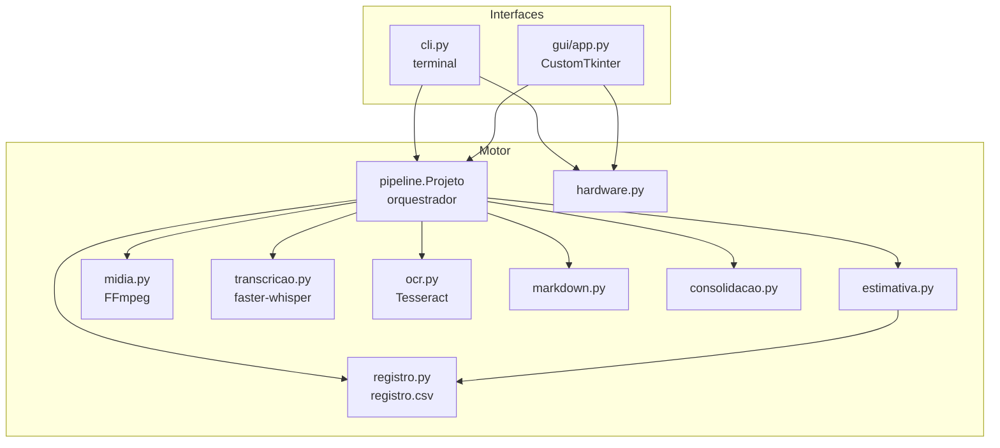
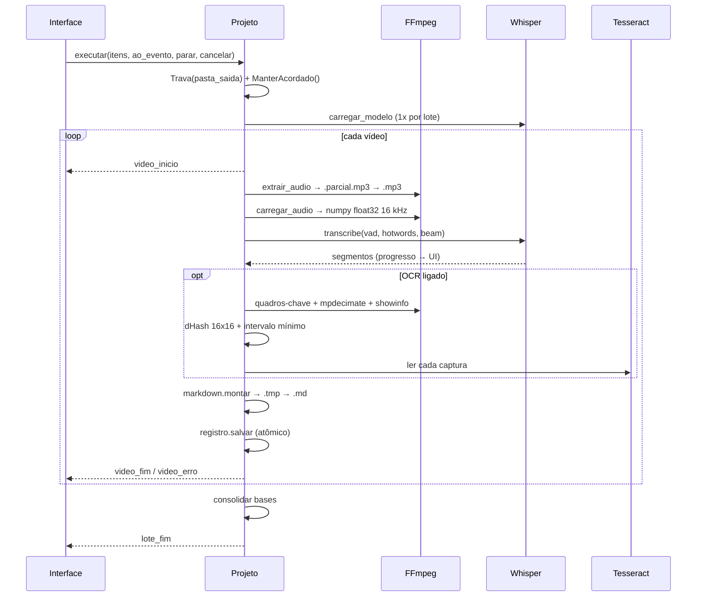
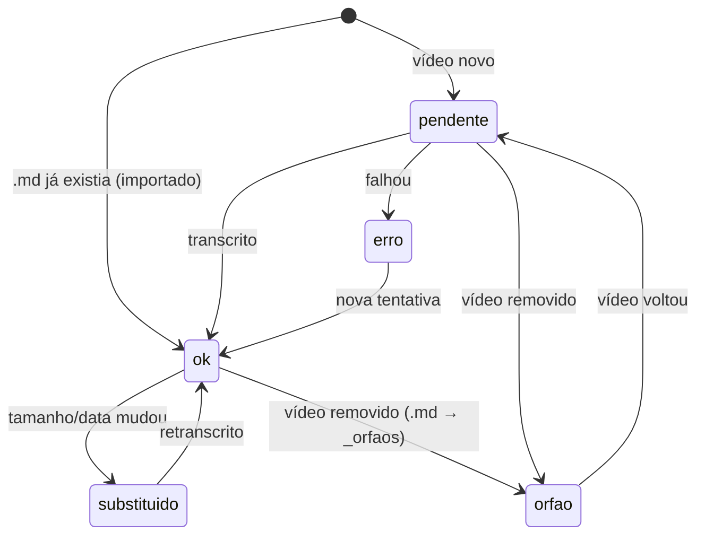

# Arquitetura

## Visão geral

O projeto separa o **motor** (lógica, sem interface) das **interfaces** (terminal e janela). As duas interfaces conversam só com `pipeline.Projeto` e recebem **eventos**. Com isso, a mesma lógica é testada uma vez e servida por qualquer interface (inclusive uma futura web local).

## Módulos

| Módulo | Responsabilidade | Dependências externas |
|---|---|---|
| `config.py` | `Config` (dataclass), predefinições de qualidade, persistência em `transcritor_config.json` | — |
| `util.py` | Tempo `hh:mm:ss`, localização de binários (embutidos ou PATH), subprocessos sem janela e sem stdin, trava de pasta, impedir suspensão | `psutil` (opcional) |
| `midia.py` | Duração (ffprobe), extração de áudio, decodificação para numpy, capturas de tela | FFmpeg, Pillow, numpy |
| `transcricao.py` | Carregar modelo (GPU→CPU), transcrever em parágrafos, cancelamento | faster-whisper / CTranslate2 |
| `ocr.py` | Detectar Tesseract, baixar português, ler imagem, limpar e deduplicar texto | Tesseract |
| `registro.py` | Identidade dos vídeos, status, métricas, sincronização com a pasta | — |
| `estimativa.py` | Tempo previsto: padrão conservador → mediana medida | — |
| `markdown.py` | Montagem do `.md` com blocos "Na tela" no ponto certo | — |
| `consolidacao.py` | Bases por subpasta com divisão por limite de palavras | — |
| `hardware.py` | Diagnóstico com nível (ok/aviso/erro/info) e explicação | `psutil`, PowerShell (Windows) |
| `pipeline.py` | Varredura, sincronização, execução do lote, eventos | todos acima |

## Fluxo de um vídeo

## Eventos

| Tipo | Dados | Uso |
|---|---|---|
| `lote_inicio` | `total`, `segundos_previstos`, `duracao_total` | Cabeçalho da rodada |
| `etapa` | `texto` | Log ("Extraindo áudio...", "Lendo texto da tela 3/40...") |
| `video_inicio` | `indice`, `total`, `rel`, `duracao` | Linha atual / tabela |
| `progresso` | `pos`, `total`, `rel` + (após 30 s) `velocidade`, `falta_video`, `falta_lote`, `termino` | Barras e previsão |
| `video_fim` | `rel`, `palavras`, `segundos`, `velocidade`, `telas` | Marca concluído |
| `video_erro` | `rel`, `erro` | Marca erro, o lote continua |
| `aviso` | `texto` | Problemas não fatais |
| `lote_fim` | `ok`, `erro`, `cancelado`, `parado` | Libera a interface |

A GUI recebe os eventos de uma thread de trabalho por `queue.Queue` e os consome a cada 150 ms na thread principal, porque o Tkinter não é thread-safe.

## Identidade e estados (registro.csv)

Um vídeo é identificado por **caminho relativo + tamanho + data de modificação**.

- O CSV usa `;` e vírgula decimal, para abrir corretamente no Excel/Power BI em português.
- A gravação é atômica (`.tmp` → `replace`). Se o Excel travar o arquivo, o app tenta 5 vezes e depois grava uma cópia `registro_PENDENTE_feche_o_excel.csv`.
- Apenas vídeos com status `ok` entram na base consolidada.

## Robustez

| Situação | Proteção |
|---|---|
| Queda/interrupção no meio | Áudio, `.md` e CSV são escritos em temporário e renomeados no fim |
| Vídeo corrompido | Exceção por vídeo: vira `erro`, o lote segue |
| Duas janelas na mesma saída | `Trava` com PID em `.em_uso.lock` |
| PC suspende à noite | `SetThreadExecutionState` (Windows) durante o lote |
| `.exe` sem console (stdout `None`) | `garantir_saidas_padrao()` redireciona para `transcritor.log` |
| ffmpeg "comendo" o teclado no terminal | Todos os subprocessos com `stdin=DEVNULL` |
| GPU NVIDIA com bibliotecas quebradas | Volta para CPU automaticamente |

## Empacotamento

- **PyInstaller onedir** (`packaging/transcritor.spec`): dois executáveis compartilhando `_internal/`: `TranscritorLocal.exe` (janela) e `TranscritorLocal-terminal.exe`.
- O workflow `build-windows.yml` gera o `.zip` no GitHub Actions (Windows), embute `ffmpeg.exe`/`ffprobe.exe` em `bin/` com as licenças e roda um teste de fumaça.
- `util.localizar_binario` procura primeiro em `<app>/bin`, depois no PATH.
