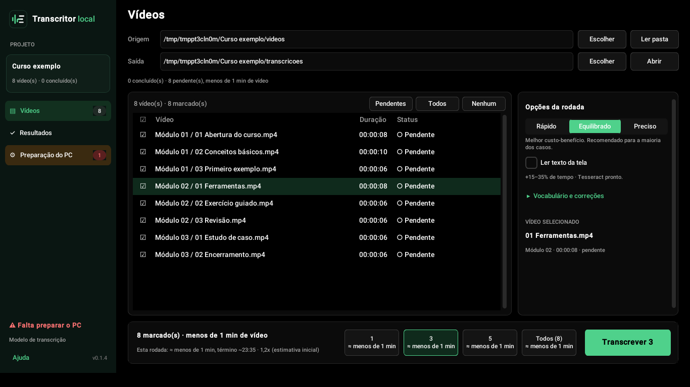

# Guia do usuário

Para quem nunca programou. Leva ~15 minutos para preparar o PC na primeira vez.

## 1. Escolha o caminho

| Caminho | Para quem | O que instalar |
|---|---|---|
| **A. Executável (.exe)** | Quem só quer usar | Nada além do app (o FFmpeg é baixado por ele na primeira vez) |
| **B. Código-fonte (Python)** | Quem quer mexer no código | Python + FFmpeg + bibliotecas |

O Tesseract é **opcional** nos dois caminhos: só é necessário para ler o texto que aparece na tela.

---

## 2. Caminho A: executável

1. Em **Releases**, baixe `TranscritorLocal-vX.Y.Z-windows.zip`. Enquanto não houver Release, use **Actions → Build Windows (.exe) → execução mais recente → Artifacts → TranscritorLocal-windows** (é preciso estar logado no GitHub).
2. Descompacte em `C:\TranscritorLocal` (evite o OneDrive e a Área de Trabalho sincronizada).
3. Abra **`TranscritorLocal.exe`**.
4. Se aparecer "O Windows protegeu o computador": **Mais informações → Executar assim mesmo**. Isso ocorre porque o app não tem assinatura digital paga, não porque é perigoso. O código é aberto e está neste repositório.

5. Na primeira vez, o app abre na página **Preparação do PC**. Clique em **Baixar FFmpeg** (~115 MB) e depois no botão de download do "Modelo de transcrição" (~0,5 GB no Rápido, ~1,6 GB no Equilibrado e no Preciso). Cada um é baixado uma única vez. Você não precisa instalar Python.

> O modo terminal existe só para quem roda pelo código-fonte (`python transcrever.py`).

## 3. Caminho B: código-fonte

### 3.1 Python

Verifique se já tem Python no PowerShell:

```powershell
python --version
```

| Resultado | O que fazer |
|---|---|
| `Python 3.10` a `3.13` | Pronto, siga para o 3.2 |
| `3.14` ou mais novo | Provavelmente funciona; se a instalação das bibliotecas falhar, instale a 3.13 |
| Abriu a Microsoft Store / "não reconhecido" | Instale a **3.13** em python.org → "Windows installer (64-bit)" e **marque "Add python.exe to PATH"** |

### 3.2 FFmpeg (obrigatório)

```powershell
winget install --id Gyan.FFmpeg -e
```

**Feche e reabra o PowerShell** e confirme com `ffmpeg -version`.

### 3.3 Bibliotecas

Se o seu Python estiver dentro do **OneDrive**, pause a sincronização antes (ícone da nuvem → engrenagem → Pausar sincronização → 2 horas).

```powershell
cd C:\caminho\para\transcritor-local
python -m pip install --upgrade pip
python -m pip install -r requirements.txt
```

### 3.4 Abrir

```powershell
python -m transcritor            # janela
python transcrever.py            # terminal (usa as pastas .\videos e .\saida)
```

## 4. Tesseract (opcional: texto da tela)

```powershell
winget install --id UB-Mannheim.TesseractOCR -e
```

O pacote de **português** é baixado automaticamente pelo app na primeira vez (~2 MB, na sua pasta de usuário, sem precisar de administrador). Para conferir, abra a página **Preparação do PC** na barra lateral.

## 5. Usando o app



A barra lateral tem três páginas: **Vídeos** (onde se trabalha), **Resultados** (o que já foi transcrito e o registro de atividades) e **Preparação do PC** (o que falta instalar ou baixar). Se faltar algo obrigatório, o app abre direto na Preparação.

| Passo | Onde | O que fazer |
|---|---|---|
| 1 | **Origem** | **Escolher** → a pasta dos vídeos. Subpastas são respeitadas; pastas que começam com `_` são ignoradas. A lista aparece sozinha (ou use **Ler pasta**) |
| 2 | **Saída** | É sugerida automaticamente (`<pasta>_transcricoes`). Não pode ficar **dentro** da pasta de vídeos. **Abrir** mostra a pasta |
| 3 | Tabela | Clique na **caixinha** (1ª coluna) para marcar ou desmarcar; clique no nome para ver os detalhes ao lado. Os pendentes já vêm marcados. **Pendentes / Todos / Nenhum** marcam em bloco |
| 4 | Opções da rodada | Qualidade, ler texto da tela e, em "Vocabulário e correções", as dicas de termos |
| 5 | Barra de baixo | O botão **Transcrever N** roda os vídeos marcados na lista e mostra o tempo estimado. Antes de começar, o app pede confirmação |

Durante a rodada, a barra de baixo mostra as etapas, o progresso e o término previsto, e a barra lateral repete o andamento. As pastas ficam travadas até o fim.

**Dicas de qualidade:**
- **Equilibrado** é o padrão recomendado. **Preciso** é ~1,5–2x mais lento. **Rápido** usa um modelo menor e erra mais termos técnicos.
- No **vocabulário**, coloque nomes que aparecem nos vídeos e que o Whisper costuma errar: `Power BI, DAX, ChatGPT, Claude, Gemini, hook`.
- A primeira estimativa é **conservadora**. Depois do primeiro vídeo, o app passa a usar a velocidade real do seu PC.

**Se a rodada não terminar bem**, a mensagem final diz exatamente o que houve: ✅ concluída, ⚠️ parcial (alguns com erro), ⏸ parada/cancelada ou ❌ falha. O som de conclusão só toca quando tudo deu certo.

**No terminal**, o código de saída diz o resultado: 0 concluído · 1 falha · 2 parcial · 3 parado/cancelado.

**Para lotes grandes:** escolha um número de vídeos que caiba em uma noite. O app impede o PC de suspender enquanto trabalha, mas **não desligue** o computador.

## 6. Levando para a IA

Qualquer IA entende o `.md`: ele é texto puro e traz, no topo, o cabeçalho **"Como ler este arquivo"** (o que são os `[hh:mm:ss]`, o que são os blocos "Na tela" e o que **não** existe). Não precisa mandar a pasta inteira: o `.mp3`, o `registro.csv` e a configuração não ajudam a IA.

| Situação | O que subir |
|---|---|
| **1 vídeo, numa conversa** | O `.md` de `transcricoes_md\`. É o arquivo principal |
| **Quer que a IA veja os slides** | Clique em **Pacote para IA** (página Resultados) e anexe **a pasta inteira**: o `.md` junto com as imagens de `imagens\`, ou o `.zip` quando a ferramenta aceitar. No teste cego com três IAs, foram as imagens que mostraram diagramas que o OCR não leu por completo. **Algumas IAs não abrem `.zip`** e, sem o conteúdo, podem inventar o resumo (aconteceu num teste): se a sua não abrir, anexe o `.md` e as imagens soltos |
| **Poucos vídeos** | Os `.md` individuais |
| **Muitos vídeos, ferramenta que indexa fontes** (NotebookLM, Projetos do Claude, GPTs personalizados) | Os arquivos de `base_consolidada\` (já divididos por tamanho). No NotebookLM, os `.md` individuais deixam as respostas citarem o vídeo exato |

Num chat comum, o limite é a janela de contexto da IA: um vídeo de 36 minutos tem ~7 mil palavras de fala. Muitos vídeos juntos não cabem; use uma ferramenta que indexa fontes ou mande só os do assunto.

A IA reconstrói **o que foi dito e o texto que apareceu na tela**. Gráficos, pessoas e layout só serão descritos na v0.2 (IA visual).

⚠️ **Material de trabalho ou sigiloso:** revise e anonimize os `.md` (nomes, matrículas, números de processo) **antes** de subir para qualquer IA na nuvem.

## 7. Problemas comuns

| Mensagem / sintoma | Causa | Solução |
|---|---|---|
| `python não é reconhecido` | Python fora do PATH | Reinstale marcando "Add to PATH", ou use `py` no lugar de `python` |
| Abre a Microsoft Store ao digitar `python` | Atalho do Windows | Configurações → Aplicativos → Aliases de execução → desligue `python.exe` e `python3.exe` |
| `FFmpeg não encontrado` | No executável: o FFmpeg ainda não foi baixado. No código-fonte: terminal aberto antes da instalação | Executável: **Preparação do PC → Baixar FFmpeg**. Código-fonte: feche e reabra o PowerShell |
| `unexpected keyword argument 'metadata_errors'` | PyAV novo incompatível com faster-whisper | Já resolvido nesta versão (o áudio é lido pelo FFmpeg) |
| Parece travado em "Carregando modelo" | Download de até ~1,6 GB na primeira vez | Aguarde. Depois funciona offline |
| `Falha ao carregar o modelo ... 403/proxy` | Rede corporativa bloqueando o download | Baixe o modelo uma vez em outra rede |
| Aviso sobre "symlinks" do Hugging Face | Limitação do Windows | Inofensivo (já silenciado) |
| `registro_PENDENTE_feche_o_excel.csv` | O `registro.csv` estava aberto no Excel | Feche o Excel e rode de novo |
| "Pasta de saída já está sendo usada" | Duas janelas na mesma saída | Feche a outra janela |
| Muito lento | CPU antiga ou poucos núcleos | Use **Rápido**; rode à noite |
| Vídeo com status "erro" | Arquivo corrompido ou sem áudio | Abra no player para conferir; ele é tentado de novo na próxima rodada |
| Vídeo "✓ Concluído · ⚠ tela não lida" | O Tesseract ou o FFmpeg falhou ao ler a tela; a fala está salva | Veja o motivo no `.md` (linha "Texto de tela") e no `registro.csv`. Abra **Preparação do PC** |
| `.em_uso.lock` / "pasta já está sendo usada" | Outra janela, ou uma leitura em andamento | Aguarde ou feche a outra janela. Uma trava esquecida por um app que fechou à força é retomada sozinha |
| Caminho muito longo | Limite de 260 caracteres do Windows | Use nomes de pasta mais curtos ou ative "caminhos longos" no Windows |
| "Pasta de saída de outro projeto" | A saída escolhida já guarda transcrições de **outra** pasta de vídeos | Vídeos diferentes: escolha outra saída. Só moveu ou renomeou a pasta de vídeos: "A pasta foi movida, continuar" (no terminal, `--pasta-movida`) |
| "As pastas mudaram" | Você trocou uma pasta depois de "Ler pasta" | Clique em **Ler pasta** de novo |
| Arquivo `aula [mp4].md` | Dois vídeos com o mesmo nome e extensões diferentes na mesma pasta | Normal: cada um tem a própria transcrição |

## 8. Medir a velocidade no seu PC (opcional)

O app escolhe sozinho quantos núcleos usar (os núcleos **físicos**; em Intel híbrido, só os de desempenho). Para conferir no seu processador:

1. Baixe `ferramentas/medir_threads.py` do repositório e salve numa pasta onde o Python e o `faster-whisper` funcionem.
2. Abra o PowerShell **nessa pasta** (Shift + botão direito num espaço vazio → "Abrir janela do PowerShell aqui"). Digite `dir` para conferir que o arquivo aparece.
3. Rode, trocando pelo caminho de um **arquivo** de vídeo com fala nos primeiros 3 minutos (botão direito no vídeo → "Copiar como caminho"):
   ```
   python medir_threads.py "C:\pasta\do\video.mp4"
   ```
4. Espere 10 a 15 minutos sem usar o PC. O resultado mostra a velocidade com 4, 6 e 12 threads (mude com `--threads 4,8,16`).

| Erro comum | Correção |
|---|---|
| `Arquivo não encontrado: C:\...\videos` | Aponte para o **arquivo** (`...\videos\aula.mp4`), não para a pasta |
| Espaço depois da aspa: `" C:\..."` | Tire o espaço: `"C:\..."` |

## 9. Acelerar com NVIDIA (opcional)

Só para placas **NVIDIA**. Placas AMD e Intel não são usadas pelo motor atual.

```powershell
python -m pip install nvidia-cublas-cu12 "nvidia-cudnn-cu12==9.*"
```

Se a página **Preparação do PC** mostrar "NVIDIA com CUDA detectada", está pronto. Se a GPU falhar, o app volta para a CPU sozinho.
