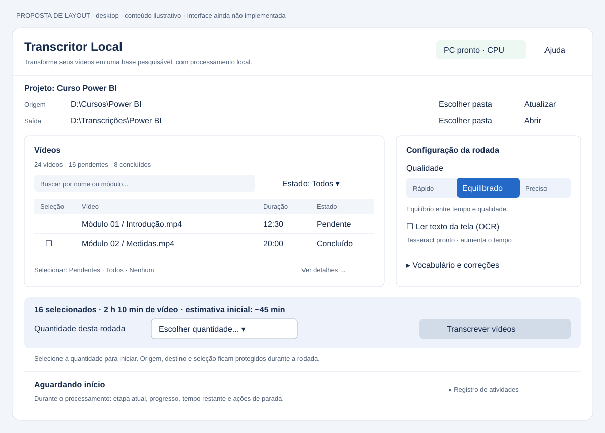

# Auditoria independente — 08/10/2026

Auditoria da versão **0.1.1**, commit **`c0c3415c6b6117351b2c5a8fa305c2b9f09d312c`**, realizada pelo Codex com revisão de interface por um agente especializado. Material salvo no repositório por solicitação do responsável pelo projeto, para consulta e continuidade pelo Claude ou outro revisor.

## Visualizar o desenho



[Abrir imagem PNG](layout-proposto.png) · [Abrir versão vetorial SVG](layout-proposto.svg)

Este desenho representa uma proposta; a interface do aplicativo não foi modificada.

## Ordem de leitura

1. [Relatório técnico](RELATORIO.md): 16 achados, severidade, evidências, limitações, discordâncias com a auditoria anterior e plano de correção.
2. [Interface e layout](INTERFACE_E_LAYOUT.md): revisão especializada, acessibilidade, proposta desktop e critérios de aceite. Alguns problemas coincidem com os achados técnicos; não somar os dois relatórios como defeitos independentes.
3. [Wireframe visual](layout-proposto.svg): organização sugerida, com conteúdo ilustrativo; não é a interface implementada.
4. [Evidências das reproduções](evidencias.json) e [script utilizado](reproducoes.py): verificações adicionais executadas em arquivos temporários.
5. [Dependências instaladas na auditoria](dependencias-instaladas.txt): registro histórico das versões resolvidas, não um lockfile de produção nem uma declaração de versões homologadas.

## Para continuar com o Claude

Sugestão de mensagem:

> Leia `docs/auditorias/2026-10-08/README.md`, o relatório técnico e a revisão de interface dessa pasta. Compare os achados com o código atual e com `docs/DECISOES.md`; as referências e evidências foram produzidas no commit indicado. Priorize integridade dos dados e coerência do projeto antes do redesenho. Para cada correção autorizada, reproduza o defeito, implemente a solução e valide com regressões relevantes. Diferencie achados reproduzidos, revisão estática e aspectos ainda não validados. Preserve a escolha explícita obrigatória de quantidade por rodada (ADR-007).

Os relatórios registram o estado na data da auditoria: **não representam correções já aplicadas**. Não marcar um achado como resolvido apenas porque a suíte original passa; relacionar a correção e a validação ao respectivo ID. Este pacote documenta resultados e recomendações; não autoriza, por si só, publicação de releases ou envio de material do usuário.

## Reproduzir as verificações adicionais

Na raiz do repositório, com as dependências instaladas e FFmpeg/Tesseract disponíveis:

```bash
python docs/auditorias/2026-10-08/reproducoes.py
```

O script preserva exatamente a reprodução usada nesta sessão Linux e requer Tesseract em `/usr/bin/tesseract`, como na máquina auditada. Em outros sistemas, adaptar esse caminho antes de interpretar o resultado `falha_ocr`; executável inexistente também produz string vazia e não demonstra o mesmo cenário. Requer o pacote `transcritor` instalado, por exemplo em ambiente virtual com `python -m pip install -e ".[dev]"`. Usa `TemporaryDirectory`, mídia inválida sintética e mocks explicitados; não processa conteúdo pessoal nem baixa modelos. O JSON impresso serve para comparar o comportamento; o script **não é uma suíte de aprovação** e pode terminar com código zero mesmo quando evidencia um defeito. Depois de correções, é esperado que alguns resultados mudem. Preservar `evidencias.json` como registro histórico; se necessário, gravar uma nova execução em outro arquivo.

Os testes originais tiveram **19 aprovações, nenhuma falha e nenhum skip** em Python 3.12.14/Linux. A transcrição com modelo real, a GUI interativa e o pacote em Windows físico não foram validados nesta auditoria.

## Relação com a documentação existente

- [Briefing da auditoria independente](../../AUDITORIA_CODEX.md): escopo e formato pedidos originalmente.
- [Auditoria anterior](../../AUDITORIA.md): correções e pendências já conhecidas.
- [Decisões técnicas](../../DECISOES.md): justificativas e restrições de produto.
- [Roadmap](../../ROADMAP.md): evolução planejada.

A instrução de não alterar arquivos durante a auditoria foi respeitada na inspeção. A inclusão posterior deste pacote e dos links de documentação foi solicitada explicitamente pelo responsável pelo projeto; não modifica o funcionamento do aplicativo.
